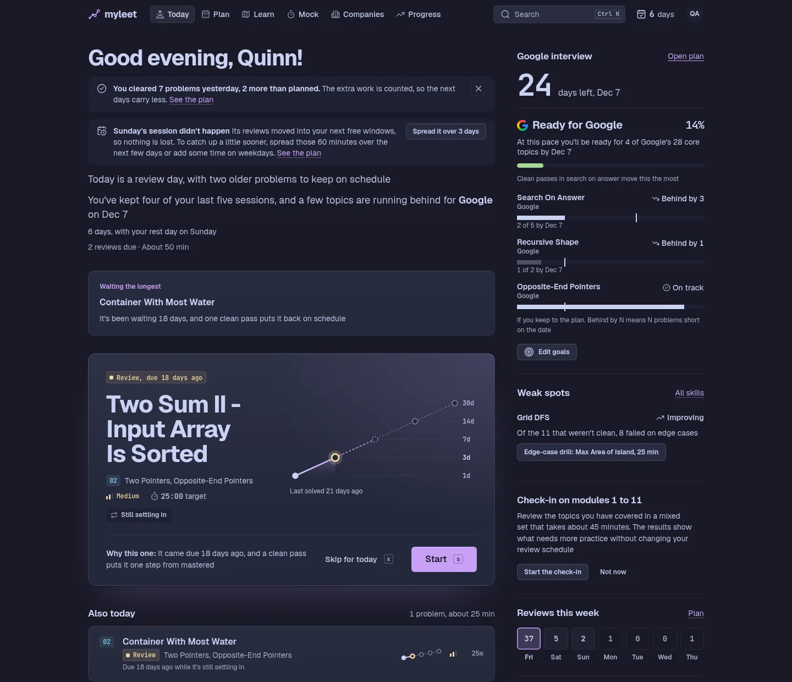
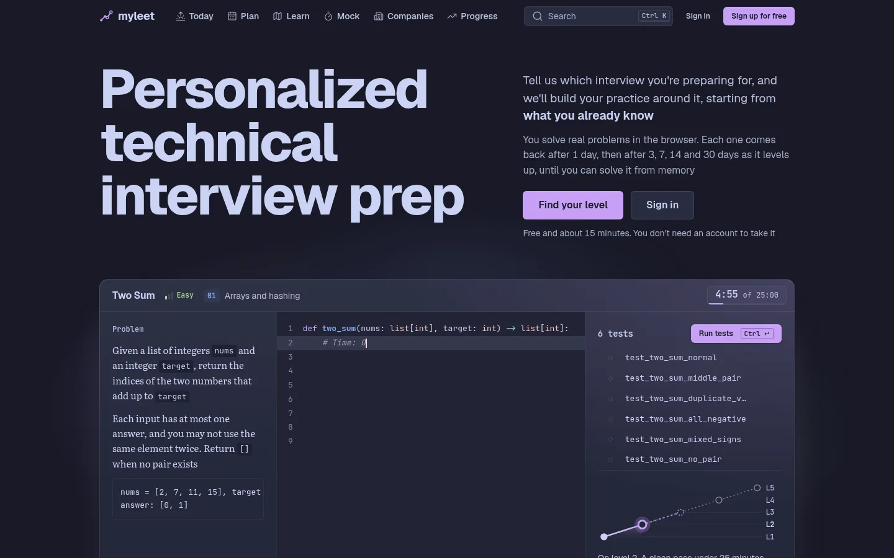
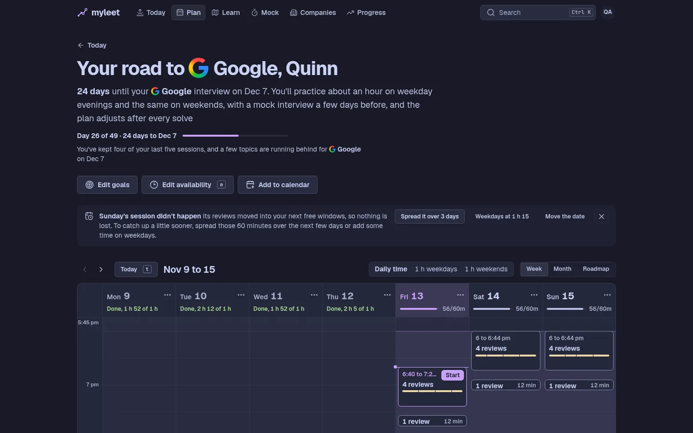
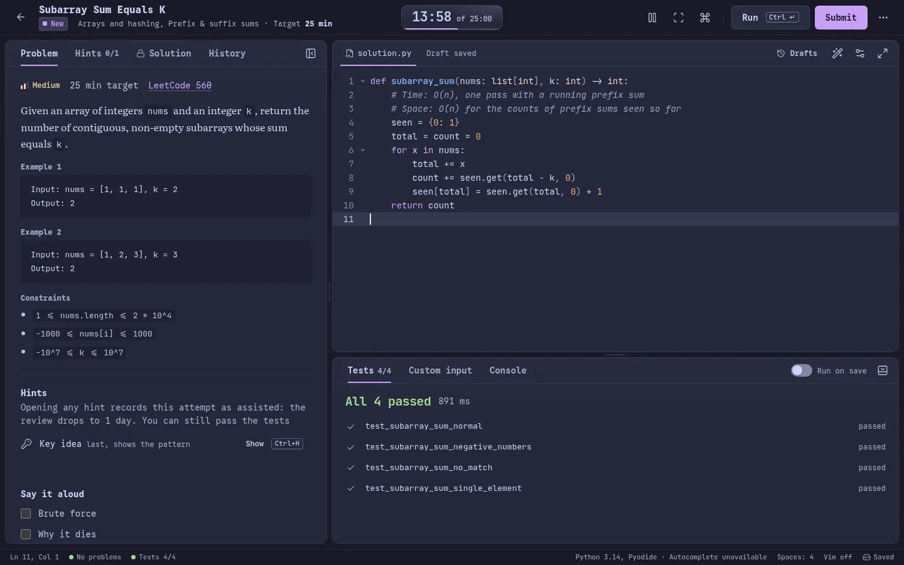
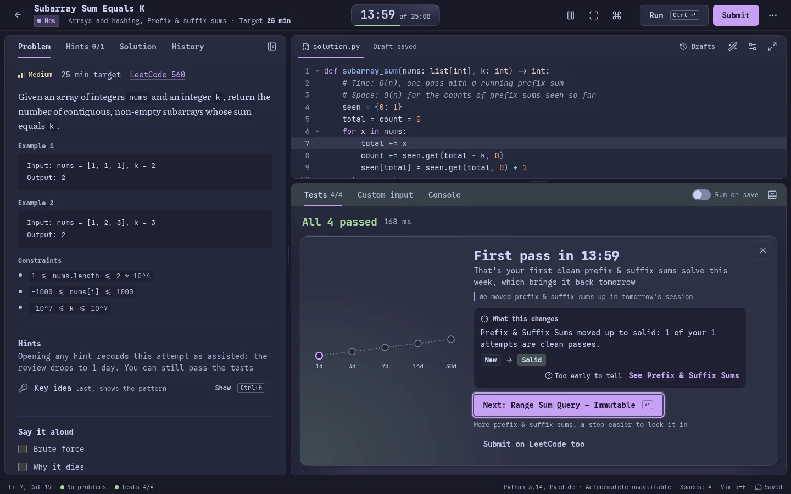
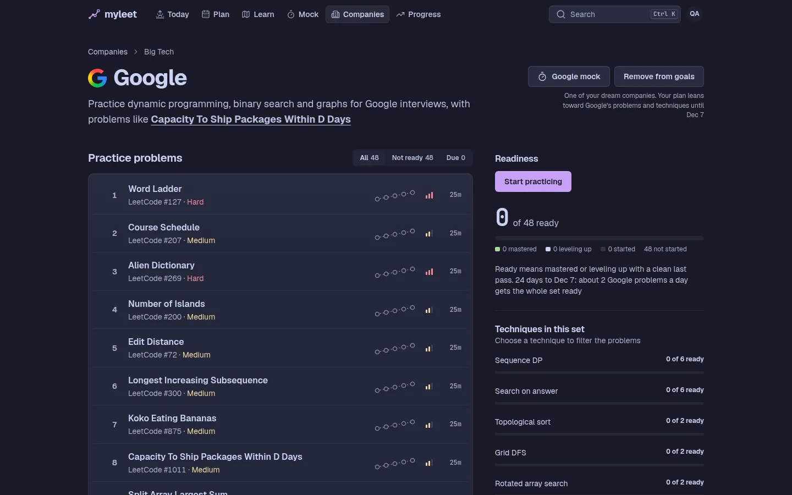
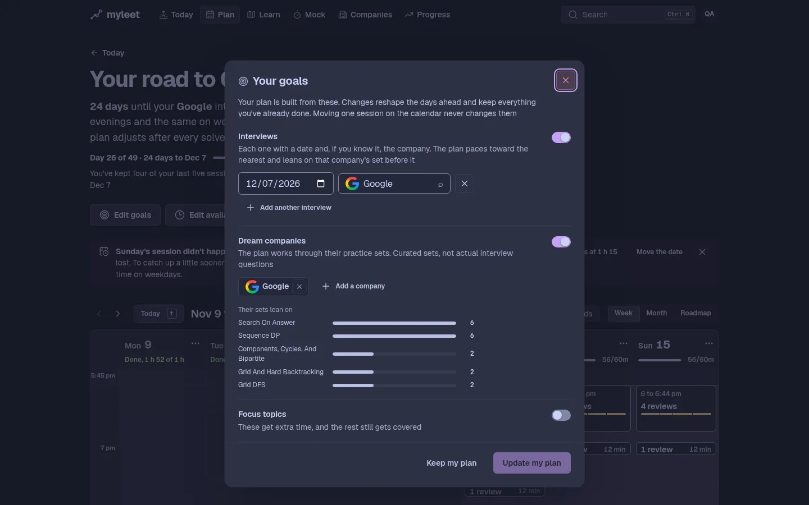
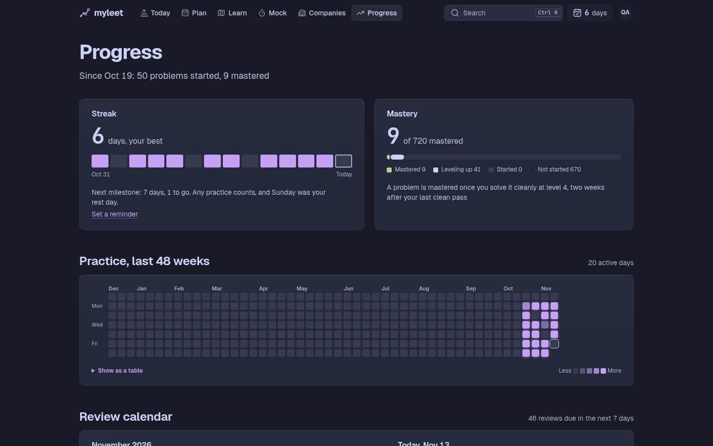
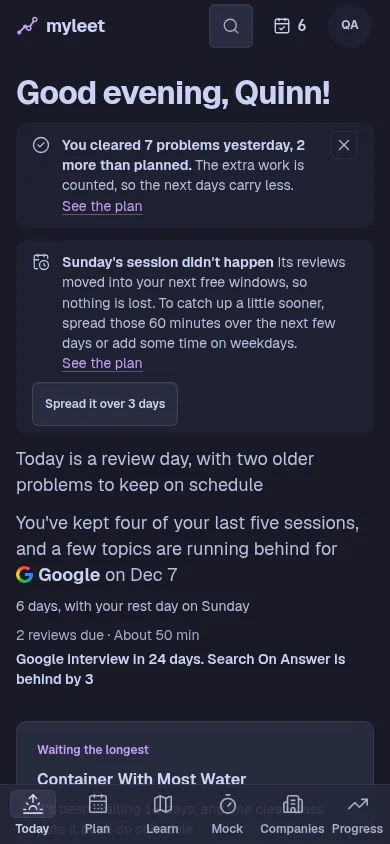
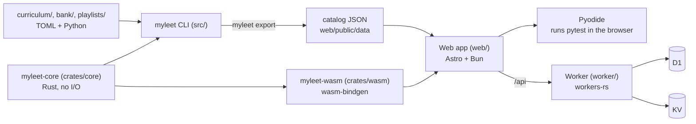

<div align="center">

<picture>
  <source media="(prefers-color-scheme: dark)" srcset=".github/readme/logo-dark.svg">
  
</picture>

# myleet

**Personalized LeetCode interview prep that remembers what you're weak at**

You solve real problems in the browser against real tests. myleet finds your starting point, plans each day
around your interview date and free hours, and brings every problem back until you can solve it cold

[](https://github.com/kidskoding/myleet/actions/workflows/ci.yml)
[](https://github.com/kidskoding/myleet/actions/workflows/deploy.yml)
[](https://myleet.anirudhkonidala.workers.dev)
[](curriculum)
[](playlists)
[](LICENSE)
<br>
[](Cargo.toml)
[](crates/wasm)
[](web)
[](web)
[](https://pyodide.org)
[](worker)

### [Try it at myleet.anirudhkonidala.workers.dev](https://myleet.anirudhkonidala.workers.dev)

[How it works](https://myleet.anirudhkonidala.workers.dev/how-it-works) ·
[Start here](guide/01_how_to_prep.md) ·
[Privacy](https://myleet.anirudhkonidala.workers.dev/privacy) ·
[Report a bug](https://github.com/kidskoding/myleet/issues)

<br>



</div>

## Screenshots

<table>
  <tr>
    <td width="50%"><br><sub>The landing page, with a working editor preview</sub></td>
    <td width="50%"><br><sub>Plan: a week of sessions placed inside your free hours</sub></td>
  </tr>
  <tr>
    <td><br><sub>The workspace mid-solve, with the tests run in the browser</sub></td>
    <td><br><sub>The result sheet after a clean pass</sub></td>
  </tr>
  <tr>
    <td><br><sub>A company set (Google) with readiness by technique</sub></td>
    <td><br><sub>The goals editor: interviews, dream companies, focus topics and time</sub></td>
  </tr>
  <tr>
    <td><br><sub>Progress: streak, mastery and 48 weeks of practice</sub></td>
    <td align="center"><br><sub>Today on a phone</sub></td>
  </tr>
</table>

## Why myleet

### The problem it solves

Most people prepare by working down a list of a few hundred problems once. A problem you solved three weeks ago
with the editorial open is one you may not be able to start in an interview, and nothing on the list tells you
which ones those are. The lists are also **the same for everyone**, so a learner who already knows two pointers
spends the same days on it as someone who has never seen it. A list also can't tell **how you miss**: whether you
can't start, pick the wrong idea, trip on edge cases or run out of time

myleet **keeps that record for you**. Every attempt is logged as events (opened, ran the tests, used a hint, passed,
gave up), and every page reads its suggestions from that history

### Personalization

- The **diagnostic** takes about **15 minutes** and needs **no account**. It starts with eight multiple-choice questions,
  each showing a real problem and asking which pattern solves it, then gives you up to three coding problems in
  the normal editor from the patterns you were least sure of. Each pattern comes out strong, shaky or "start
  here", and the first "start here" pattern becomes the **first module of your plan**
- **Goals mix freely**. You can add interviews (each with a date and, if you know it, the company), dream companies
  whose sets the plan works through, focus topics that get extra time, a daily time budget for weekdays and
  weekends, or none of these to just stay sharp
- The **plan** walks forward **one day at a time** to your interview date (or four weeks ahead without one) and places
  sessions **inside the hours you said you are free**. **Due reviews come first**, then mock interviews, check-ins and new
  problems. It stops adding new problems in the last two days before an interview. A missed day moves its work
  into your next free windows, and you can subscribe to the plan from **Google, Apple or Outlook calendars**
- Today opens with short **coaching notes built from your history**, such as "You cleared 7 problems yesterday, 2
  more than planned" or "Sunday's session didn't happen", each with a way to adjust the plan. Each problem says
  **why it was picked** ("It came due 18 days ago, and a clean pass puts it one step from mastered")
- After every submit, the **result sheet** says **what the attempt changed**: the problem's new level, how the
  technique's diagnosis moved, and the next problem to try

### Learning that sticks

- Every problem you finish sits on one of **five review levels**. It comes back after 1, 3, 7, 14 and then 30 days,
  and it counts as **mastered at level 4**, the 14-day level
- A level moves up only on a **clean pass**: every test passes, no hint or solution was opened first, the timer was
  never restarted, and you finished inside the **25-minute target**. A second clean pass on the same day leaves the
  level alone. Anything else sends the problem **back to level 1**
- Once a technique has two or more attempts and a low score, myleet **names the most likely cause** from how those
  attempts went (can't start, wrong approach, edge cases, too slow or forgetting) and suggests a next step that
  fits it, such as "Edge-case drill: Max Area of Island, 25 min"
- **Eighteen modules of notes** teach each pattern **before the drills**. The notes are written to start from the brute
  force and show why it is too slow, trace the technique by hand, and cover what to say out loud

### Real interview conditions

You write Python in a CodeMirror editor and run it against each problem's pytest file **in the browser** with
Pyodide, so there is **nothing to install**. The timer starts on your first keystroke, and every problem has the same
**25-minute target**, about what one problem gets in a live round. **Mock interviews** run for **25, 45 or 60 minutes**
depending on how many problems you take on. They don't name the technique, keep hints hidden during the round
and end with a self-check on whether you could explain your approach and its complexity

### Company sets

There are **285 sets** across Big Tech, AI and startups, consumer and business tech, trading firms and the
Fortune 500. Each set covers **live coding rounds only**, never online assessments or behavioral rounds. The larger
sets are built from **counted candidate reports**: the script in [`tools/evidence`](tools/evidence) collects public
interview posts from 2024 on and treats a problem as evidenced once at least two separate posts name it (four for
an easy problem in Big Tech). Each file cites its sources in a comment at the top, prefers **United States reports**
and labels the location of any from elsewhere. Sets built on thin evidence **say so**, for example "Estimate from 6
candidate reports (medium confidence)". Learners can also mark **"I was asked this"** on a problem, and a company's
count shows once three people report the same one

### Your data

myleet is **free and open source** under the MIT license. An account keeps your settings and practice events and
**syncs them across devices**, and your browser keeps a copy so practice works offline. The optional LeetCode import
asks only for a username and reads **public profile data**. It **never** asks for, or stores, a LeetCode password,
session or cookie

### How it compares

This is our best reading of each tool. "Partial" means it covers part of the row, and "?" means we could not
confirm it

|                                       | myleet | LeetCode                           | NeetCode / Grind 75                              | AlgoMonster                  | Anki decks                   |
| ------------------------------------- | ------ | ---------------------------------- | ------------------------------------------------ | ---------------------------- | ---------------------------- |
| Runs your code against tests          | Yes    | Yes                                | Partial (NeetCode runs code, Grind 75 links out) | Yes                          | No                           |
| A diagnostic that sets your start     | Yes    | No                                 | No                                               | ?                            | No                           |
| Spaced review graded by real results  | Yes    | No                                 | No                                               | ?                            | Partial (you grade yourself) |
| A plan paced to your date and hours   | Yes    | No                                 | Partial (Grind 75 sets weeks and hours)          | ?                            | No                           |
| Company sets with cited sources       | Yes    | Partial (Premium tags, no sources) | No                                               | ?                            | No                           |
| Explanations built from your attempts | Yes    | No                                 | No                                               | No                           | No                           |
| Free                                  | Yes    | Partial (Premium is paid)          | Partial (NeetCode Pro is paid)                   | Partial (most of it is paid) | Mostly (the iOS app is paid) |

### Who it's for

myleet is for students heading into internship and co-op interviews, new grads, and anyone with an interview on
the calendar or a company they want to work at someday. If you have a date, it **paces you to it**. If you don't, it
keeps a **steady routine** of new patterns and reviews

## How it works

1. The **diagnostic** marks each pattern strong, shaky or "start here" and picks your first module
2. Your goals (interviews, dream companies, focus topics and daily time) shape a **day-by-day plan** inside your free
   hours
3. Today lists **due reviews first**, most overdue first, then new problems up to your daily number (three unless you
   change it), with weak techniques ahead of the rest
4. A **clean pass** inside the **25-minute target** moves a problem up one level, and anything else sends it back to
   level 1

```text
Level 1 (1 day) → Level 2 (3 days) → Level 3 (7 days) → Level 4 (14 days, mastered) → Level 5 (30 days)
```

A missed review **stays due without losing its level**, and it waits at the top of Today until you get to it. The full
rules, with a worked example, are on the [How it works](https://myleet.anirudhkonidala.workers.dev/how-it-works)
page

## Curriculum

720 problems in eighteen modules, ordered by interview pattern rather than textbook chapter, plus 911
playlist-only problems in `bank/` that company sets can open

|     | Module                   | Focus                             |
| --- | ------------------------ | --------------------------------- |
| 01  | Arrays and hashing       | maps, sets, prefix sums, Kadane   |
| 02  | Two pointers             | converging and fast-slow pointers |
| 03  | Stacks and queues        | LIFO, monotonic stack and deque   |
| 04  | Sliding window           | contiguous constraints            |
| 05  | Binary search            | sorted space, search on answer    |
| 06  | Linked lists             | pointers, reverse, merge          |
| 07  | Trees                    | DFS and BFS, BST, serialize       |
| 08  | Heaps                    | top K, two heaps, k-way merge     |
| 09  | Backtracking             | search with pruning               |
| 10  | Graphs                   | BFS and DFS, topo sort, paths     |
| 11  | Dynamic programming      | overlapping subproblems           |
| 12  | Greedy algorithms        | exchange arguments                |
| 13  | Intervals                | merge, sweep, difference arrays   |
| 14  | Tries                    | prefix queries                    |
| 15  | Bit manipulation         | masks, XOR                        |
| 16  | Math and geometry        | number theory, grids              |
| 17  | Advanced                 | union-find, Fenwick, string algos |
| 18  | Mixed interview practice | timed mixed drills                |

## Architecture



| Part    | Stack                                                   | What it does                                                                        |
| ------- | ------------------------------------------------------- | ----------------------------------------------------------------------------------- |
| Core    | Rust, `crates/core`                                     | Review levels, the planner, skill scores, Today's picks and the "Why this one" text |
| Browser | `crates/wasm`, wasm-bindgen                             | Exposes the core to the web app as a JSON API                                       |
| Web app | Astro, Bun, TypeScript, CodeMirror 6, Pyodide           | Every page, plus the editor and the in-browser test runner                          |
| Backend | Cloudflare Workers in Rust (workers-rs), D1 and KV      | Sign-in, progress sync, problem statements, reports and the LeetCode import         |
| CLI     | Rust, `src/`                                            | Validates content, runs reference solutions and exports the catalog for the site    |
| Content | TOML and Python in `curriculum/`, `bank/`, `playlists/` | Problems, tests, notes and company sets                                             |

## Privacy

Your account stores your profile, your settings and your practice events, plus the plan built from them. Your code
is not uploaded. There are no ads, trackers or analytics. The LeetCode import reads public profile data (solved
counts, topic counts and recent accepted problems) from a username you enter, and myleet never stores a LeetCode
session or cookie. You can export or delete everything from Settings. The details are on the
[Privacy](https://myleet.anirudhkonidala.workers.dev/privacy) page

## Development

You need Rust, [Bun](https://bun.sh), [uv](https://docs.astral.sh/uv/) and
[just](https://github.com/casey/just). The repo's `devenv.nix` provides all of them, plus wasm-pack, through `devenv shell`

```bash
git clone https://github.com/kidskoding/myleet.git && cd myleet
devenv shell
uv sync --group dev
just export          # catalog JSON into web/public/data
just wasm            # browser bindings into web/src/wasm
cd web && bun install && bun run dev
```

`just web-dev` runs the same steps in one go. The dev server re-exports the catalog when `playlists/`,
`curriculum/`, `bank/` or `guide/` change, and it proxies `/api/statement` to the live site

### Checks

Every push to master runs CI, and Deploy ships the site only when CI passes. Run the matching recipe before you
commit, or `just ci` for everything

| You changed                             | Run                                                  |
| --------------------------------------- | ---------------------------------------------------- |
| Rust in `src/`, `crates/` or `worker/`  | `just ci-rust`                                       |
| Anything in `web/`                      | `just ci-web`                                        |
| Problems, notes, playlists or `bank/`   | `just ci-content`, then `just export`                |
| Python or Markdown anywhere             | `just ci-python`                                     |
| The worker, migrations or deploy config | `just cd-check` (the Deploy build without deploying) |

### Adding a problem

Each problem is a folder inside its module's technique:

```text
curriculum/NN_<module>/techniques/NN_<technique>/NNN_<problem>/
├── problem.toml      id, title, difficulty, leetcode, url, key_idea, hints, prompt
├── starter.py        the signature, Time and Space comments, raise NotImplementedError
├── test_problem.py   pytest tests that import from solution
└── solution.py       optional reference solution, checked in CI
```

A problem that no module teaches but a company set needs goes in `bank/<NN_topic>/<NNN_slug>/` with the same files
and a `solution.py`. Then run `myleet validate --lock` and `myleet check --solutions <id>`, and commit
`problem-ids.lock` with the problem. Saved progress is keyed by the problem `id`, so never rename or remove one

### Adding a company set

Add `playlists/NNN_<slug>.toml` with `title`, `group`, a one-sentence `focus` about live coding rounds, and
`review_modules`, then one `[[entries]]` table (`title`, `url`) per problem, most asked first. Start the file with a
`# Sources (checked <date>):` comment listing the reports it is based on, United States first, and keep your
research notes in `tools/playlists/research/<slug>.md`. Every entry should open on the site, so if a problem is
missing from the curriculum, add it to `bank/` first. The `NNN_` prefix only sets display order; the slug after it
is permanent. [CLAUDE.md](CLAUDE.md) has the full content and writing rules

## Roadmap

- A LeetCode browser extension for two-way sync
- Email sign-in
- Error alerting for the site and the Worker
- Research for the remaining Fortune 500 sets
- A smoother flow from one problem to the next

## Credits

- [Catppuccin](https://catppuccin.com) for the color palette
- [Geist](https://vercel.com/font), [Archivo](https://fonts.google.com/specimen/Archivo),
  [Literata](https://fonts.google.com/specimen/Literata) and [JetBrains Mono](https://www.jetbrains.com/lp/mono/)
  for type, through Fontsource
- [Pyodide](https://pyodide.org) for running Python in the browser and
  [CodeMirror](https://codemirror.net) for the editor
- [Lucide](https://lucide.dev) for interface icons
- Company logos from [Simple Icons](https://simpleicons.org), [theSVG](https://thesvg.org),
  [Lobe Icons](https://github.com/lobehub/lobe-icons), Wikimedia Commons and other sources listed in
  [web/src/assets/logos/README.md](web/src/assets/logos/README.md). Logos remain the trademarks of their owners
- Google Calendar, macOS Calendar and Outlook app icons from Wikimedia Commons, in
  [web/public/brand](web/public/brand)

## License

[MIT](LICENSE). Problem statements belong to their original sources, such as LeetCode, and link back to them
